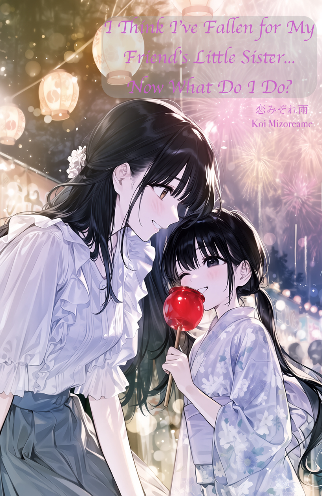

## Original Title

友達の妹に恋しちゃったんだけど……どうしよ

## Description

### I'd never once felt my heart flutter over another girl

Not until this spring, when I, Miyanomori Yuu, experienced my very first love.

It started innocently enough. I went over to the house of a new friend, was shown into the living room, and we chatted about this and that.

But then, in an instant, everything changed.

The atmosphere shifted. It felt as though time itself had stopped, yet my heart was racing like crazy.

Even so, I couldn't bring myself to admit what I was feeling... that I'd fallen in love.

Because the person I'd fallen for wasn't—

My friend, or a classmate. She wasn't my age, nor was she my friend's sibling or parent.

She was my friend's... little sister.


   

     
       <a href="{{ site.baseurl }}/docs/tags.html#{{ tag | slugify }}" class="label label-blue">{{ tag }}</a>
     
   

   

The original Japanese Web Novel can be found on [kakuyomu].\
Author: Koi Mizoreame [恋みぞれ雨]

[kakuyomu]: https://kakuyomu.jp/works/16818792436251076302
[恋みぞれ雨]: https://kakuyomu.jp/users/glislily1111
